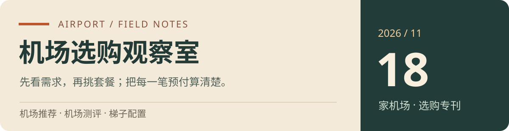

# 机场推荐与机场测评 2026｜18家机场清单与梯子选购专刊
机场梯子VPN哪个好用？目前有太多翻墙工具让人不知如何选择，能否一个梯子软件能解决大部分设备的科学上外网问题（Android安卓梯子，IOS苹果梯子，Windows电脑梯子），其实目前科学上网机场梯子都已经具备了全客户端翻墙上网的能力。今天推荐2025年五款高端的翻墙机场，支持 SSR、V2ray、Trojan 等多种主流翻墙协议，可以轻松导入Clash或小火箭等翻墙插件使用。
<picture>
  
</picture>

**更新月份：2026-11** · 18家机场 · 171条套餐记录 · 月付、按量与长期方案分开比较

选机场，先弄清自己需要怎样的连接，再比较哪份套餐更合适。这份**机场推荐**按价格、流量、设备数、客户端、线路权限和付款方式整理18家候选；每篇**机场测评**既列出代表套餐，也解释不同档位的取舍。想找日常梯子、低频备用流量或特定地区的节点，可以沿着下面的需求入口阅读。

📚 [打开本版全部文章](docs/README.md) · [直接查171条套餐](docs/comparisons/plan-browser.md)

> 🧭 **先选需求，再选一家。** 同一场景列出的多家是备选，不需要全部购买。顺位由维护者安排，不是统一实测速率排名。价格与规则可能变化，付款前核对结算页；本月编排不表示所有资料刚刚核实。

[省流推荐](#quick-choice) · [18家完整榜单](#airport-ranking) · [逐家机场测评](#airport-reviews) · [按预算与用途筛选](#decision-desk) · [梯子配置与排查](#toolkit) · [选购问答](#questions)

## 🧭 省流推荐｜从你的使用习惯出发

| 你最看重什么 | 先比较这些备选 | 先看的方案 | 决定前看一眼 |
| --- | --- | --- | --- |
| ⚡ 性价比 | [Flybit](#flybit) 或 [西游云](#xiyou) | Flybit ¥15/月128GB；西游 ¥9/月120GB | 西游低价档与标准型专线权限不同 |
| 🍜 便宜量大 | [西游云](#xiyou) 或 [星辰云](#xingchen-cloud) | 西游 ¥16/月200GB；星辰 ¥17/月200GB | 低价与专线资料分档核对 |
| 💎 出口与高端配置 | [CocoDuck](#cocoduck) 或 [WgetCloud](#wgetcloud) | CocoDuck ¥17/月100GB；Wget ¥99/月230GB | 家宽落地与专线分层是不同关注方向 |
| 🎒 低频按量 | [Flybit](#flybit) | ¥36/次128GB；¥68/次256GB | 总量用完为止，非每月到账 |
| 🎒 低频按量 | [星辰云](#xingchen-cloud) | ¥98/次300GB；¥199/次1000GB | IEPL标注；一次性总量，非每月到账 |
| 📱 自有客户端与规则 | 先看[客户端限制表](docs/comparisons/access-and-limits.md) | 灵动、自由猫先确认官方客户端要求 | 飞鸟云另有IPv6与Hysteria2门槛 |
| 🗓️ 低频年内方案 | [灵动云](#lingdong) 或其他年付小档 | 穿云 ¥99/年70GB总量 | 年内总量与每月重置的年付不同 |

**第一次买机场，从这里开始：** [七步选购流程](docs/field-guide/first-airport.md) → [计费方式说明](docs/field-guide/billing.md) → [按具体需求比较](docs/comparisons/decision-cases.md)。

## 🏆 完整机场榜单｜18家顺序一次看全

| 排名 | 机场 · 点击读本页测评 | 普通月付起步参考 | 选择前最重要的区别 |
| :---: | --- | --- | --- |
| 1 | [Flybit](#flybit) | ¥15/月 · 128GB/月 | IEPL标注 · 月付与按量 · 不限设备 |
| 2 | [西游云](#xiyou) | ¥9/月 · 120GB/月 | 9元月付 · 分层节点 · 不限时备选 |
| 3 | [CocoDuck](#cocoduck) | ¥17/月 · 100GB/月 | 家宽落地方向 · 17元月付 · 配套加油包 |
| 4 | [灵动云](#lingdong) | ¥20/月 · 100GB/月 | 官方客户端 · 多周期 · 年内流量与不限时分开 |
| 5 | [老猫云](#laomao) | ¥20/月 · 100GB/月 | 20元月付 · 45元季付 · 协议有变更 |
| 6 | [WgetCloud](#wgetcloud) | ¥99/月 · 230GB/月，30天重置 | 99元月付起 · 在线IP限制 · 分档专线 |
| 7 | [MESL](#mesl) | ¥50/月 · 200GB/月 | 50元普通月付起 · 5台设备 · 地区限定方案 |
| 8 | [星辰云（星辰机场）](#xingchen-cloud) | ¥8/月 · 80GB/月 | 8元月付 · 多周期 · 按量包 |
| 9 | [极客云](#jike-cloud) | ¥19.99/月 · 100GB，套餐到期时清零 | 19.99元起 · 分档设备数 · 标准版起IPLC |
| 10 | [飞鸟云](#feiniaoyun) | ¥10/月 · 200GB/月 | 10元200GB按量 · IPv6门槛 · 不退款 |
| 11 | [妙妙云（秒秒云）](#miaomiao-cloud) | ¥14/月 · 128GB/月 | 14元月付 · 年付小档 · 不限时备用 |
| 12 | [飞兔云](#feituyun) | ¥9.9/月 · 118GB/月 | 9.9元118GB · 三档不限时 · 明确不退款 |
| 13 | [扬帆云](#yangfanyun) | ¥19.99/月 · 100GB/周期 | 19.99元起 · LV分层 · 设备限制清楚 |
| 14 | [动力港](#dongligang) | ¥8/月 · 100GB/月 | 8元100GB · 三档不限时 · 套餐可能覆盖 |
| 15 | [XSUS](#xsus) | ¥10/月 · 168GB/月 | 10元168GB · BGP宣传 · 不叠加规则 |
| 16 | [CyberGuard机场](#cyberguard) | ¥32/月 · 350GB/月 | 32元月付 · 半年入门 · 多档不限时 |
| 17 | [自由猫](#freecat) | ¥6/月 · 30GB/月 | 6元30GB · 指定客户端 · 不限时方案 |
| 18 | [极速云](#jisu-cloud) | ¥15.99/月 · 1200GB标称/月，按6倍约200GB可传输/月 | 15.99元起 · 6倍计费 · 设备分档 |

💡 MESL地区优化不算普通月付起步；各家完整周期、按量和加油包见后面的价格表。“妙妙云”对应项目现有“秒秒云”资料，本版标注两种名称。

🔐 **保存账号、密码、邮箱、订单与官方通知渠道。** 收藏本资料库，便于查找变更后的机场入口；不要公开完整订阅地址。

## 📖 逐家机场测评｜读懂套餐背后的选择

首页共展示124条代表套餐。每家优先列3–4档月付、2档按量与有记录的长期周期，具体数量按已有方案安排；完整配置、全部套餐和购买前问题在独立详情页展开。

## 01 · Flybit｜把日常月付和低频按量分开选

  <picture>
    
  </picture>

Flybit放在本期机场推荐第一位，主要因为购买方式清楚：持续使用看月付，不定期使用看不限时。它不需要靠高额预付降低表面月费，128GB月付与128GB按量可以直接按自己的使用节奏比较。

## [👉 点击进入官网](https://goflybit.com/register?code=m4qRDLA1)

**💰 怎么选套餐：** 日常先看15元128GB，月流量超过128GB再比较22元192GB、28元256GB；偶尔使用则从36元128GB总量开始，不把一次性流量误当作每月到账。

| 代表套餐 | 实付金额／周期 | 流量 | 推荐指数 |
| --- | ---: | --- | :---: |
| 每月-128G | ¥15/月 | 128GB/月 | ⭐⭐⭐⭐⭐ |
| 每月-192G | ¥22/月 | 192GB/月 | ⭐⭐⭐⭐⭐ |
| 每月-256G | ¥28/月 | 256GB/月 | ⭐⭐⭐⭐⭐ |
| 每月-512G | ¥52/月 | 512GB/月 | ⭐⭐⭐⭐⭐ |
| 不限时-128G | ¥36/次 | 128GB不限时 | ⭐⭐⭐⭐⭐ |
| 不限时-256G | ¥68/次 | 256GB不限时 | ⭐⭐⭐⭐ |
| 不限时-512G | ¥128/次 | 512GB不限时 | ⭐⭐⭐⭐ |
| 不限时-1024G | ¥238/次 | 1024GB不限时 | ⭐⭐⭐⭐ |

**🔎 这家机场测评看什么：** 套餐条目写明IEPL专线，但这一标签没有包含你所在城市到入口的完整路径。选节点时仍要同时看本地运营商、常用地区和实际连接表现；不限设备也只说明设备数这一项，不等于无限带宽或允许多人转售。

**⚖️ 还要算清的账：** 36元和15元不能只按价格高低排优先级：前者购买总流量，后者购买一个月的使用期限与月度额度。连续用三个月但总量较少时，按量可能更省；每月都接近128GB时，月付更容易控制单位成本。

**🎯 适合怎样使用：** 适合手机、电脑切换使用，且希望同一家机场同时覆盖主用与备用购买方式的人。已经习惯第三方客户端的用户，可以先核对协议和导入格式，再决定客户端是否继续沿用。

**🧩 是否匹配你的条件：** 不适合把“专线”理解为所有地区都固定低延迟的人；需要固定出口、团队授权或专门业务保障时，应先问清楚交付规则。

**📌 付款前核对：**

- 不限时包的账户有效期、流量有效期和叠加方式分别是什么？
- 常用地区是否在当前套餐权限内？
- 续费、换套餐会不会覆盖剩余流量？

[展开Flybit完整机场测评与全部套餐](docs/reviews/flybit.md) · [回到18家机场榜单](#airport-ranking)

---

## 02 · 西游云｜低月费先入门，专线权限单独比较

  <picture>
    
  </picture>

西游云的看点是从小预算起步，再按需求增加节点权限。9元轻量型和16元标准型的差别不只有80GB流量，设备数量、节点范围与精品专线标注也不同。

## [👉 点击进入官网](https://e.xiyou666.xyz/?code=s7S4hVxm)

**💰 怎么选套餐：** 预算优先先看9元120GB；希望比较精品IEPL与家宽资料时看16元200GB。每月用到数百GB再考虑38元500GB，不必先为用不到的额度付款。

| 代表套餐 | 实付金额／周期 | 流量 | 推荐指数 |
| --- | ---: | --- | :---: |
| 轻量型 | ¥9/月 | 120GB/月 | ⭐⭐⭐⭐⭐ |
| 标准型 | ¥16/月 | 200GB/月 | ⭐⭐⭐⭐⭐ |
| 高能型 | ¥38/月 | 500GB/月 | ⭐⭐⭐⭐⭐ |
| 标准型不限时 | ¥98/次 | 300GB总量 | ⭐⭐⭐⭐⭐ |
| 高能型不限时 | ¥159/次 | 600GB总量 | ⭐⭐⭐⭐ |
| 轻量型（年付） | ¥90/年 | 120GB/月，共12个月 | ⭐⭐ |
| 高能型（年付） | ¥290/年 | 500GB/月，共12个月 | ⭐⭐ |

**🔎 这家机场测评看什么：** 轻量型月付明确不含高速精品专线，标准型及以上才有相应标注。轻量型年付记录却有不同的线路说明，所以同名套餐换了周期后，也应重新核对节点权限，不能直接套用月付介绍。

**⚖️ 还要算清的账：** 90元是轻量型全年预付款，不是可以单独按7.5元购买的月付；98元300GB与159元600GB则是不限时总量。主用按每月额度估算，备用按累计用量估算，两种账本不能混在一起。

**🎯 适合怎样使用：** 适合需要便宜机场、但愿意花一点时间对照套餐细则的用户。多设备家庭应先数同时在线的设备，再对照5台、8台、12台等限制，避免只按总流量选档。

**🧩 是否匹配你的条件：** 如果你只想买最低价，却又要求全部精品节点和不限设备，轻量型就不符合这个组合。

**📌 付款前核对：**

- 轻量型月付与年付当前分别包含哪些节点？
- 高能型不同周期的设备规则是否仍有区别？
- 按量包是叠加流量还是替换现有套餐？

[展开西游云完整机场测评与全部套餐](docs/reviews/xiyou.md) · [回到18家机场榜单](#airport-ranking)

---

## 03 · CocoDuck｜关注家宽落地，先把常规套餐和加油包分开

  <picture>
    
  </picture>

CocoDuck适合把出口类型和目标平台放在价格之前比较的用户。常规月付17元100GB起，商店对全部节点和不限设备有标注；家宽落地是资料方向，不代表每个节点都能满足同一种平台需求。

## [👉 点击进入官网](https://www.cocoduck.site/auth/register?code=e2c254b876)

**💰 怎么选套餐：** 轻量日常看17元个人套餐，稳定超过100GB再比较31元200GB。77元迷你鸭是年付、每月40GB；10元50GB加油包依赖已有套餐，不能代替独立机场订阅。

| 代表套餐 | 实付金额／周期 | 流量 | 推荐指数 |
| --- | ---: | --- | :---: |
| 个人套餐 | ¥17/月 | 100GB/月 | ⭐⭐⭐⭐⭐ |
| 精英套餐 | ¥31/月 | 200GB/月 | ⭐⭐⭐⭐⭐ |
| 家庭套餐 | ¥75/月 | 500GB/月 | ⭐⭐⭐⭐⭐ |
| 团队套餐 | ¥115/月 | 1000GB/月 | ⭐⭐⭐⭐⭐ |
| 迷你鸭77 | ¥77/年 | 40GB/月，共12个月 | ⭐⭐ |

**🔎 这家机场测评看什么：** 当前资料提及BGP中转和家宽落地，不把它改写成已确认的IEPL专线。关心AI或流媒体时，先确定需要的国家和出口属性，再确认套餐实际能使用的节点，而不是看到“全部节点”就推定全部平台可用。

**⚖️ 还要算清的账：** 家庭、团队套餐主要扩大流量，名称本身不构成共享账号许可。若只在某个月多用几十GB，可比较加油包与升档的差额；若每月都需要额外流量，则应回到常规月付之间比较。

**🎯 适合怎样使用：** 适合有明确地区或IP需求、愿意先核对节点的用户。日常网页和资料查询的轻量用户也能从个人套餐开始，没必要因为高端场景分类就直接选择高额套餐。

**🧩 是否匹配你的条件：** 需要独立不限时订阅的人不应只购买加油包；需要固定IP或业务用途保障的人也不能把家宽名称当作合同承诺。

**📌 付款前核对：**

- 目标地区的家宽节点是否包含在所选套餐内？
- 加油包何时到期，换套餐是否保留？
- 家庭或团队套餐允许的使用范围是什么？

[展开CocoDuck完整机场测评与全部套餐](docs/reviews/cocoduck.md) · [回到18家机场榜单](#airport-ranking)

---

## 04 · 灵动云｜先确认官方客户端，再挑月付或年内小包

  <picture>
    
  </picture>

灵动云的套餐跨度很大，20元100GB月付、99元70GB年内总量，以及三档一次性流量包分别面向不同频率。它最先需要确认的并非价格，而是客户端使用方式。

## [👉 点击进入官网](https://varnexa.lingdongaff.com/#/?code=s1cZDFEb)

**💰 怎么选套餐：** 初次比较从拂风20元100GB月付开始。穿云99元提供的是70GB/年总量，不是每月70GB；199元闲云150GB则按一次性不限时资料记录，两者的有效期与配额逻辑不同。

| 代表套餐 | 实付金额／周期 | 流量 | 推荐指数 |
| --- | ---: | --- | :---: |
| 灵动·拂风 | ¥20/月 | 100GB/月 | ⭐⭐⭐⭐⭐ |
| 灵动·驭浪 | ¥50/月 | 300GB/月 | ⭐⭐⭐⭐⭐ |
| 灵动·破晓 | ¥100/月 | 700GB/月 | ⭐⭐⭐⭐⭐ |
| 灵动·凌霄 | ¥180/月 | 1.5TB/月 | ⭐⭐⭐⭐⭐ |
| 灵动·闲云 | ¥199/次 | 150GB总量，不限时 | ⭐⭐⭐⭐ |
| 灵动·惊云 | ¥499/次 | 400GB总量，不限时 | ⭐⭐⭐⭐ |
| 灵动·拂风 | ¥57/季 | 100GB/月 | ⭐⭐⭐⭐ |
| 灵动·拂风 | ¥204/年 | 100GB/月 | ⭐⭐ |

**🔎 这家机场测评看什么：** 文字介绍宣传Trojan专线，所附样本的节点类型却出现VLESS，不能把协议写成单一已核实结论。维护者在资料末尾明确补充不支持URL通用订阅、需要官方客户端，本版本优先采用这项补充。

**⚖️ 还要算清的账：** 拂风有月、季、半年、年、两年和三年价格，长期预付跨度远大于普通月付。驭浪、破晓和凌霄也是同样结构；在没有连续使用记录前，仅看折算月费不足以决定长周期购买。

**🎯 适合怎样使用：** 适合接受官方客户端、希望在软件内配置规则的用户。如果已有Clash配置、路由器订阅或自动更新流程，应先确认能否迁移；不能把“可配置规则”理解为必然可以导出通用订阅。

**🧩 是否匹配你的条件：** 必须使用URL订阅导入自有客户端的人，现有资料已提示不适合。私人定制还需要确认节点、带宽、设备和交付约定，不按名称推定专属资源。

**📌 付款前核对：**

- 官方客户端支持自己的系统版本吗？
- 穿云70GB的统计周期和重置条件是什么？
- 定制月付620元与重置包618元分别对应什么操作？

[展开灵动云完整机场测评与全部套餐](docs/reviews/lingdong.md) · [回到18家机场榜单](#airport-ranking)

---

## 05 · 老猫云｜有协议变更记录，订阅兼容性要走在价格前面

  <picture>
    
  </picture>

老猫云已有资料覆盖50GB至500GB月流量，最小记录是45元一季、每月50GB，能单独月付的起步则是20元100GB。两种门槛应分别理解。

## [👉 点击进入官网](https://www.laomaourl.com?path=register&code=4BbwAhIU)

**💰 怎么选套餐：** 希望降低首次预付看C套餐20元100GB月付，流量较多再看30元200GB和40元300GB。B套餐45元是季度总价；F套餐150元500GB与前几档价差明显，需核对额外权限。

| 代表套餐 | 实付金额／周期 | 流量 | 推荐指数 |
| --- | ---: | --- | :---: |
| C套餐 | ¥20/月 | 100GB/月 | ⭐⭐⭐⭐⭐ |
| D套餐 | ¥30/月 | 200GB/月 | ⭐⭐⭐⭐⭐ |
| E套餐 | ¥40/月 | 300GB/月 | ⭐⭐⭐⭐⭐ |
| F套餐 | ¥150/月 | 500GB/月 | ⭐⭐⭐⭐⭐ |
| B套餐 | ¥45/季 | 50GB/月 | ⭐⭐⭐⭐ |

**🔎 这家机场测评看什么：** 旧介绍使用Trojan与IEPL表述，后续文字记录有从Trojan切换至Vmess的更新，而附图仍显示Trojan。这里只记录冲突，客户端应以当前订阅实际输出为准，不把历史协议当成今天的配置承诺。

**⚖️ 还要算清的账：** 现有价格来自提供的第三方评测摘录，而非同批商店面板。文章里的性能结果、平台解锁和评论都不等于本项目的测试；也不将个别评论直接写成全体用户体验结论。

**🎯 适合怎样使用：** 适合能够更新订阅、核对客户端内核的用户。若原来的客户端突然失效，先确认协议迁移与订阅地址变化，再排查本地设置，避免把配置失配误认为套餐流量不足。

**🧩 是否匹配你的条件：** 需要明确当前退款时限、设备数量或固定协议的人，先向后台确认再付款。资料中的SLA宣传不能替代你实际获得的售后条款。

**📌 付款前核对：**

- 当前实际输出Vmess还是其他协议？
- B至F套餐的现价和设备规则是否仍与记录一致？
- 退款条件、处理渠道和期限是否有书面说明？

[展开老猫云完整机场测评与全部套餐](docs/reviews/laomao.md) · [回到18家机场榜单](#airport-ranking)

---

## 06 · WgetCloud｜高价档的差别，要落到节点与在线IP权限

  <picture>
    
  </picture>

WgetCloud的月付门槛高于这份榜单中的多数机场。99元、109元和119元三档不只是流量相差20GB，在线IP、连接数、速率参数和节点等级也逐项增加。

## [👉 点击进入官网](https://invite.wgetcloud.ltd/auth/register?code=fZ0Rsm)

**💰 怎么选套餐：** 个人需求先比较三档月付。精品团队M、L为10464元和15200元年付总价，属于完全不同的预付规模，不适合用作个人最低起价。

| 代表套餐 | 实付金额／周期 | 流量 | 推荐指数 |
| --- | ---: | --- | :---: |
| 基础专线服务 | ¥99/月 | 230GB/月，30天重置 | ⭐⭐⭐⭐⭐ |
| 优质专线服务 | ¥109/月 | 250GB/月，30天重置 | ⭐⭐⭐⭐⭐ |
| 精品专线服务 | ¥119/月 | 270GB/月，30天重置 | ⭐⭐⭐⭐⭐ |
| 精品团队套餐-M | ¥10464/年 | 2880GB/月，30天重置 | ⭐⭐ |
| 精品团队套餐-L | ¥15200/年 | 5760GB/月，30天重置 | ⭐⭐ |

**🔎 这家机场测评看什么：** 资料侧重高端专线和分层节点，但基础、优质、精品的权限并不相同。常用地区是否在自己的档位、在线IP如何统计、连接数是否满足应用需求，都比单看节点总数量更直接。

**⚖️ 还要算清的账：** 3个在线IP不等于只能装在3台设备上，也不等于可以让3个人随意共享；同一网络、手机网络切换和长连接都可能影响统计。团队套餐名称同样不意味着授权用途没有限制。

**🎯 适合怎样使用：** 适合预算充足、愿意核对细则、对节点权限有明确要求的人。需要稳定工作连接时，应先在常用网络验证，再考虑更长周期；费用高不能代替本地验证。

**🧩 是否匹配你的条件：** 预算主要在十几元、只需要低频备用，或者需要资料标注不可用地区服务的人，应换一类方案。

**📌 付款前核对：**

- 所选节点在基础、优质还是精品权限内？
- 在线IP、连接数和账号共享分别如何限制？
- 2FA、手续费与售后范围有哪些要求？

[展开WgetCloud完整机场测评与全部套餐](docs/reviews/wgetcloud.md) · [回到18家机场榜单](#airport-ranking)

---

## 07 · MESL｜面板价格为主，区域优化与普通套餐分开比较

  <picture>
    
  </picture>

MESL本期按资料末尾的套餐面板整理，普通Premium月付从50元200GB起；155元50GB是年付，72元100GB是季付。前文另一套概述价不用于本版价格表。

## [👉 点击进入官网](https://panel.meslcloud.com/#/register?code=Azk8zu5v)

**💰 怎么选套餐：** 一般用户先比较50元200GB、70元300GB与110元500GB。35元100GB的新疆优化档只针对指定受限地区，不作为所有人的普通月付起价。

| 代表套餐 | 实付金额／周期 | 流量 | 推荐指数 |
| --- | ---: | --- | :---: |
| Premium 200G | ¥50/月 | 200GB/月 | ⭐⭐⭐⭐⭐ |
| Premium 300G | ¥70/月 | 300GB/月 | ⭐⭐⭐⭐⭐ |
| Premium 500G | ¥110/月 | 500GB/月 | ⭐⭐⭐⭐⭐ |
| Premium 1024G | ¥210/月 | 1024GB/月 | ⭐⭐⭐⭐⭐ |
| Premium 100G | ¥72/季 | 100GB/月，账单日重置 | ⭐⭐⭐⭐ |
| Premium 50G | ¥155/年 | 50GB/月，账单日重置 | ⭐⭐ |
| Premium Team | ¥599/月 | 3072GB/月 | ⭐⭐⭐⭐⭐ |
| Premium Enterprise Service | ¥1000/月 | 1000GB/月 | ⭐⭐⭐⭐⭐ |

**🔎 这家机场测评看什么：** 面板标注BGP、IPLC、IEPL以及最高10Gbps参数。这些是配置宣传，不是每条节点的实测速率或保证；普通档、区域优化和定制企业服务的交付方式也不能混为一谈。

**⚖️ 还要算清的账：** Premium Team为599元3072GB月付、20台设备；企业面板显示1000元/月1000GB，说明又出现500元/月起的定制文字。后者需要询价，不擅自把最低咨询金额替换成可购买套餐价格。

**🎯 适合怎样使用：** 适合愿意为较高月流量和专线资料方向支付更多预算的人。五台设备是否够用、账单日重置如何计算、是否有地区限制，是购买前能明确核对的部分。

**🧩 是否匹配你的条件：** 不能因第三方宣传中出现零丢包或极低延迟，就认定本地相同。必须使用特定客户端或规则集时，先确认当前后台提供的订阅方式。

**📌 付款前核对：**

- 普通Premium与地区优化节点的使用资格分别是什么？
- 年付50G和季付100G是否按月账单日重置？
- 企业服务最终价格、设备和交付内容如何约定？

[展开MESL完整机场测评与全部套餐](docs/reviews/mesl.md) · [回到18家机场榜单](#airport-ranking)

---

## 08 · 星辰云（星辰机场）｜低价入口与IEPL档位，要各看一遍

  <picture>
    
  </picture>

星辰云的选择多，但最低价档与常规专线档定位不同。8元80GB限2台且不提供客服支持；9.9元100GB和17元200GB，更适合分别比较一般日常与IEPL方向。

## [👉 点击进入官网](https://xc1.luniu8.com/?code=det68imC)

**💰 怎么选套餐：** 轻量用途先核对8元档限制；日常多设备比较9.9元入门版；在意IEPL与家宽资料则看17元标准版。按量备选有98元300GB与199元1000GB总量。

| 代表套餐 | 实付金额／周期 | 流量 | 推荐指数 |
| --- | ---: | --- | :---: |
| 初级版 | ¥8/月 | 80GB/月 | ⭐⭐⭐⭐⭐ |
| 入门版 | ¥9.9/月 | 100GB/月 | ⭐⭐⭐⭐⭐ |
| 标准版 | ¥17/月 | 200GB/月 | ⭐⭐⭐⭐⭐ |
| VIP版 | ¥30/月 | 450GB/月 | ⭐⭐⭐⭐⭐ |
| 不限时流量-B版 | ¥98/次 | 300GB不限时 | ⭐⭐⭐⭐⭐ |
| 不限时流量-C版 | ¥199/次 | 1000GB不限时 | ⭐⭐⭐⭐ |
| 标准版（季度） | ¥48/季 | 200GB/月 | ⭐⭐⭐⭐ |
| 入门版（年付） | ¥99/年 | 100GB/月 | ⭐⭐ |

**🔎 这家机场测评看什么：** 17元及以上月付有IEPL、原生IP与家宽IP相关标注，不能把这些配置直接套到8元或9.9元月付。某些同名年付档权限记录不同，购买时以当前周期选项为单位确认。

**⚖️ 还要算清的账：** 48元标准版是整个季度金额，99元入门版是全年金额；半年送一个月的记录另有有效期说明。长期方案既要比较总价，也要确认赠送月份和流量重置是否沿用同样规则。

**🎯 适合怎样使用：** 适合预算较细、愿意逐档比较套餐的人。将月流量和客服需求一起考虑，往往比只找最低价更容易选到适合长期使用的档位。

**🧩 是否匹配你的条件：** 需要客服协助的新手不宜只因为8元低价忽略该档无客服说明；也不要把不限时总量当作每月固定配额。

**📌 付款前核对：**

- 当前周期是否包含目标IEPL节点？
- 最小档设备与客服限制是否可以接受？
- 赠送月份、有效期和重置日如何安排？

[展开星辰云（星辰机场）完整机场测评与全部套餐](docs/reviews/xingchen-cloud.md) · [回到18家机场榜单](#airport-ranking)

---

## 09 · 极客云｜同样是月付，IPLC权限从标准版开始看

  <picture>
    
  </picture>

极客云本期位于第九，五档月付从19.99元100GB到99.99元1200GB。它的重点是分层权限：入门价不等于全部专线节点的价格。

## [👉 点击进入官网](https://jikefind.net/auth/register?code=8hg0)

**💰 怎么选套餐：** 19.99元入门版与29.99元基础版先比较基本用量和限速；关心IPLC看39.99元标准版；需要全部节点与不限速标注，再比较59.99元旗舰版。

| 代表套餐 | 实付金额／周期 | 流量 | 推荐指数 |
| --- | ---: | --- | :---: |
| 入门版 | ¥19.99/月 | 100GB，套餐到期时清零 | ⭐⭐⭐⭐⭐ |
| 基础版 | ¥29.99/月 | 200GB，套餐到期时清零 | ⭐⭐⭐⭐⭐ |
| 标准版 | ¥39.99/月 | 350GB，套餐到期时清零 | ⭐⭐⭐⭐⭐ |
| 旗舰版 | ¥59.99/月 | 600GB，套餐到期时清零 | ⭐⭐⭐⭐⭐ |
| 旗舰版大流量 | ¥99.99/月 | 1200GB，套餐到期时清零 | ⭐⭐⭐⭐⭐ |

**🔎 这家机场测评看什么：** 标准版开始记录IPLC节点，旗舰及以上标注开放全部节点。SSR、V2ray等标准协议便于比较客户端支持，但应核对实际订阅类型与内核版本，不以软件名称推定所有节点可用。

**⚖️ 还要算清的账：** 套餐还可选择半年、年和两年，但现有结构化资料没有对应的完整价格，因此这里只列可核对的月付金额。流量在套餐到期清零，续费、升档和周期切换前要确认余额处理。

**🎯 适合怎样使用：** 适合希望把设备数、流量和节点权限逐项对齐的用户。2台、3台、5台、8台、10台的档位差异明显，先数设备可减少选错档的概率。

**🧩 是否匹配你的条件：** 需要把同系服务作为完全独立灾备的人，应先考虑线路与运营关联性，不能只换一个品牌名称就视为独立备份。

**📌 付款前核对：**

- 标准版当前包含哪些IPLC节点？
- 长周期实付总价和流量清零规则是什么？
- 旗舰“不限速”的实际使用和公平使用限制有哪些？

[展开极客云完整机场测评与全部套餐](docs/reviews/jike-cloud.md) · [回到18家机场榜单](#airport-ranking)

---

## 10 · 飞鸟云｜价格很低，IPv6与Hysteria2配置先过关

  <picture>
    
  </picture>

飞鸟云的低价按量包很醒目，10元200GB、15元400GB、20元600GB均有记录。但需要自行配置IPv6，并核对Hysteria2支持，适合有一定配置经验的人。

## [👉 点击进入官网](https://feiniaoyun.xyz/#/register?code=F1BcowUV)

**💰 怎么选套餐：** 备用从10元200GB总量比较，主用另看同价的200GB月付。两个套餐数字相同，发放方式不同；12元传家宝是年付总价，不是1元可单月购买。

| 代表套餐 | 实付金额／周期 | 流量 | 推荐指数 |
| --- | ---: | --- | :---: |
| 月付200G | ¥10/月 | 200GB/月 | ⭐⭐⭐⭐⭐ |
| 月付400G | ¥15/月 | 400GB/月 | ⭐⭐⭐⭐⭐ |
| 月付600G | ¥20/月 | 600GB/月 | ⭐⭐⭐⭐⭐ |
| 不限时200G | ¥10/次 | 200GB总量，用完为止 | ⭐⭐⭐⭐⭐ |
| 不限时400G | ¥15/次 | 400GB总量，用完为止 | ⭐⭐⭐⭐ |
| 传家宝 | ¥12/年 | 50GB/月，共12个月 | ⭐⭐ |
| 传家宝（两年付） | ¥20/两年 | 50GB/月，共24个月 | — |
| 传家宝加大版 | ¥24/年 | 100GB/月，共12个月 | ⭐⭐ |

**🔎 这家机场测评看什么：** 客户端需要支持Hysteria2，而且本地网络与IPv6配置要满足实际要求。仅有客户端名称、能访问其他机场，均不能证明这家订阅已经配置正确。先确认门槛，再比较每GB价格。

**⚖️ 还要算清的账：** 月付、年付、两年付与一次性流量包同时存在，容易把便宜年费与不限时总量混淆。年付额度按月记载，而一次性包用完为止；两年付又是更长的预付承诺，不能只按平均价格排序。

**🎯 适合怎样使用：** 适合能独立检查协议、IPv6和导入格式的备用用户。多设备使用也要在每台设备上验证支持情况，不能只在手机成功连接就认为其他设备无需配置。

**🧩 是否匹配你的条件：** 需要即买即用或遇到问题必须退款的人，应重点看现有“不退款”说明；配置门槛不适合时不建议先付款再碰运气。

**📌 付款前核对：**

- 本地网络和客户端是否能按要求配置IPv6？
- 选择的是月付流量还是一次性总量？
- 重复购买、换周期和退款规则是否可接受？

[展开飞鸟云完整机场测评与全部套餐](docs/reviews/feiniaoyun.md) · [回到18家机场榜单](#airport-ranking)

---

## 11 · 妙妙云（秒秒云）｜把每档在线设备数和流量一起算清楚

  <picture>
    
  </picture>

你指定的“妙妙云”，现有项目资料名称为“秒秒云”，本版将两种写法对应到同一家，沿用原注册链接与套餐。它提供常规月付、年付小档和按量包，区别包含同时在线设备数。

## [👉 点击进入官网](https://dl2.mmy8.com/#/register?code=dUjEJXLh)

**💰 怎么选套餐：** 主用先比较14元128GB与26元256GB，分别限3台和6台。79元68GB与148元128GB是年付方案；不限时100GB为99元一次性总价，不按月补充。

| 代表套餐 | 实付金额／周期 | 流量 | 推荐指数 |
| --- | ---: | --- | :---: |
| 128G/月-探花 | ¥14/月 | 128GB/月 | ⭐⭐⭐⭐⭐ |
| 256G/月-榜眼 | ¥26/月 | 256GB/月 | ⭐⭐⭐⭐⭐ |
| 512G/月-状元 | ¥49/月 | 512GB/月 | ⭐⭐⭐⭐⭐ |
| 1024G/月-大学士 | ¥98/月 | 1024GB/月 | ⭐⭐⭐⭐⭐ |
| 不限时间100G | ¥99/次 | 100GB用完为止 | ⭐⭐⭐⭐⭐ |
| 不限时间300G | ¥268/次 | 300GB用完为止 | ⭐⭐⭐⭐ |
| 68G/特惠套餐 | ¥79/年 | 68GB/月 | ⭐⭐ |
| 200G/特惠套餐 | ¥170/年 | 200GB/月 | ⭐⭐ |

**🔎 这家机场测评看什么：** 商店记录为中转高速节点，没有足够依据将全部节点写成IEPL专线。平台支持应按实际节点确认，而不是把宣传中的流媒体或GPT支持理解为全地区保证。

**⚖️ 还要算清的账：** 从3台升到6台、9台、12台时，流量和设备额度同步增长。先数同时在线设备，再看月流量，可避免流量够用却因设备限制影响日常；年付小档也要单独核对设备数。

**🎯 适合怎样使用：** 适合希望在套餐里直接看到设备数量的用户。单人手机电脑日常用量稳定时，小档更容易估算；多设备持续同时在线时，不能只看128GB与256GB之间的流量差。

**🧩 是否匹配你的条件：** 现有条目注明不退款，不能接受这一点的用户应先考虑其他方案；需要专业专线或固定出口的人也应另核对。

**📌 付款前核对：**

- 后台品牌名称与这里的秒秒云是否一致？
- 所选档位允许几台设备同时在线？
- 不限时包与周期套餐是否覆盖，退款规则是什么？

[展开妙妙云（秒秒云）完整机场测评与全部套餐](docs/reviews/miaomiao-cloud.md) · [回到18家机场榜单](#airport-ranking)

---

## 12 · 飞兔云｜月付、不限时与年付都有，先核对地区限制

  <picture>
    
  </picture>

飞兔云拥有多档月付与不限时流量包，最低常规月付9.9元118GB。资料中的节点数量、解锁与中转能力是服务方描述；更值得先看的，是地区可用性、退款和设备规则。

## [👉 点击进入官网](https://vip.xn--h5qy75o.vip/#/register?code=zvG0LAue)

**💰 怎么选套餐：** 日常从9.9元118GB、16.9元218GB与29.9元450GB比较；备用看29.9元100GB或59.9元200GB总量。98元98GB是全年价格、每月额度，不能写成8元多的可购月付。

| 代表套餐 | 实付金额／周期 | 流量 | 推荐指数 |
| --- | ---: | --- | :---: |
| 每月118G | ¥9.9/月 | 118GB/月 | ⭐⭐⭐⭐⭐ |
| 每月218G | ¥16.9/月 | 218GB/月 | ⭐⭐⭐⭐⭐ |
| 每月450G | ¥29.9/月 | 450GB/月 | ⭐⭐⭐⭐⭐ |
| 每月1000G | ¥49.9/月 | 1000GB/月 | ⭐⭐⭐⭐⭐ |
| 100G不限时 | ¥29.9/次 | 100GB总量，用完为止 | ⭐⭐⭐⭐ |
| 200G不限时 | ¥59.9/次 | 200GB总量，用完为止 | ⭐⭐⭐⭐ |
| 年付98G | ¥98/年 | 98GB/月 | ⭐⭐ |
| 半年活动168G | ¥55/半年 | 168GB/月 | — |

**🔎 这家机场测评看什么：** 套餐文字标注中转1倍率，并以15–30台描述设备连接范围。这个区间不是一项精确的逐档设备上限，需要在下单后台核对；部分介绍提及IPLC，也不能因此把全部普通节点都写成专线。

**⚖️ 还要算清的账：** 55元168GB为半年活动记录，不是年付金额；98、138、198元是不同额度的年付。活动方案还应再次核对适用地区与有效期，不能因预付平均价低而省略限制条件。

**🎯 适合怎样使用：** 适合预算十几元、有一定自助配置能力，且希望按相同服务比较月付与按量的人。持续流量大的用户还可看1000GB或2000GB档，但应先验证日常所需地区。

**🧩 是否匹配你的条件：** 资料有新疆不可用说明且标注不退款。相关地区或必须退款保障的用户，应在付款前确认，而不是把“全球可连”宣传当作无条件覆盖。

**📌 付款前核对：**

- 所在地是否在限制范围内？
- 15–30台的实际限制如何按套餐执行？
- 半年活动的价格、有效期和不退款规则是否仍成立？

[展开飞兔云完整机场测评与全部套餐](docs/reviews/feituyun.md) · [回到18家机场榜单](#airport-ranking)

---

## 13 · 扬帆云｜LV等级同时改变设备数和专线权限

  <picture>
    
  </picture>

扬帆云的五档月付使用LV等级区分，价格、流量与设备数逐步提升。挑选时既要看100GB到1.2TB的额度，也要看LV3、LV4才出现的IEPL权限记录。

## [👉 点击进入官网](https://ml.yfqz1.net/register?code=mzd1CVsd)

**💰 怎么选套餐：** 日常看19.99元LV1或29.99元LV2；关注专线时再比较39.99元LV3与49.99元LV4。当前只有明确月付价格，不把未提供金额的不限时描述加入起步价。

| 代表套餐 | 实付金额／周期 | 流量 | 推荐指数 |
| --- | ---: | --- | :---: |
| LV1 | ¥19.99/月 | 100GB/周期 | ⭐⭐⭐⭐⭐ |
| LV2 | ¥29.99/月 | 200GB/周期 | ⭐⭐⭐⭐⭐ |
| LV3 | ¥39.99/月 | 400GB/周期 | ⭐⭐⭐⭐⭐ |
| LV4 | ¥49.99/月 | 700GB/周期 | ⭐⭐⭐⭐⭐ |
| 旗舰版·大流量 | ¥88.99/月 | 1.2TB/周期 | ⭐⭐⭐⭐⭐ |

**🔎 这家机场测评看什么：** 概况提过IPLC，但套餐条目写的是LV3部分IEPL、LV4全IEPL。这里保留更具体的分档说明，并提示核对实际节点，不用概况文字覆盖低档权限。

**⚖️ 还要算清的账：** LV1至LV4的设备数为2、3、4、6台，旗舰为8台。流量文字以“每周期”记录，月付购买前仍应确认重置规则，尤其不要把多月续费理解为流量一次性全部到账。

**🎯 适合怎样使用：** 适合希望使用常见订阅客户端，并按设备数量和线路权限逐档升级的人。既有设备只有两三台时，先按真实用量挑选，避免为暂时用不到的最高档权限付款。

**🧩 是否匹配你的条件：** 需要已知价格的按量机场、或需要低价档直接享有全部专线的人，当前资料并不支持这些组合。

**📌 付款前核对：**

- 当前LV等级实际包含哪些IEPL节点？
- 流量每周期的重置时间如何计算？
- 账号共享、设备在线和连接数是否另有规则？

[展开扬帆云完整机场测评与全部套餐](docs/reviews/yangfanyun.md) · [回到18家机场榜单](#airport-ranking)

---

## 14 · 动力港｜8元入门与大流量之间，覆盖规则尤其要看

  <picture>
    
  </picture>

动力港把套餐命名为不同舰型，常规月付从8元100GB到600元10000GB。低价和大流量之外，最需要留意的是商店反复提示的套餐覆盖规则。

## [👉 点击进入官网](https://xn--tfrza853d44tvst.xyz/#/register?code=HMPHJgwG)

**💰 怎么选套餐：** 个人主用先看8元100GB、15元200GB、20元300GB；备用可比较30元100GB、60元200GB、120元500GB一次性总量。季度24元、半年48元、年96元为100GB档的已有概述记录。

| 代表套餐 | 实付金额／周期 | 流量 | 推荐指数 |
| --- | ---: | --- | :---: |
| 驱逐舰 | ¥8/月 | 100GB/月 | ⭐⭐⭐⭐⭐ |
| 巡洋舰 | ¥15/月 | 200GB/月 | ⭐⭐⭐⭐⭐ |
| 战列舰 | ¥20/月 | 300GB/月 | ⭐⭐⭐⭐⭐ |
| 航空母舰 | ¥30/月 | 500GB/月 | ⭐⭐⭐⭐⭐ |
| 补给舰100G | ¥30/次 | 100GB总量，不限时 | ⭐⭐⭐⭐ |
| 补给舰200G | ¥60/次 | 200GB总量，不限时 | ⭐⭐⭐⭐ |
| 100G季度方案 | ¥24/季 | 100GB/月 | ⭐⭐⭐⭐ |
| 100G年度方案 | ¥96/年 | 100GB/月 | ⭐⭐ |

**🔎 这家机场测评看什么：** 资料主打中转或直连方向，商店标注70节点、流媒体与AI支持，但没有统一地区测试证据。不同运营商的体验差异只能作为选购时要验证的方向，不将二手评价写成这里的确定结论。

**⚖️ 还要算清的账：** 直接购买不同套餐、重复购买一次性套餐都可能覆盖原有方案，剩余流量未必叠加。对备用用户来说，这一规则可能比每GB便宜几分钱更重要：用完再买与提前囤包的后果完全不同。

**🎯 适合怎样使用：** 适合预算较低、愿意先验证本地入口的用户。没有必要因为最高档额度大就选10000GB套餐；个人多数时候更应关注自己每月能用掉多少，以及售后响应是否满足需要。

**🧩 是否匹配你的条件：** 不能接受覆盖剩余权益、或准备一次购买多个流量包囤积的人，先确认后台规则再付款。

**📌 付款前核对：**

- 新购、续费、升档是否覆盖剩余时间与流量？
- 季度或年度100GB方案是否仍按月重置？
- 常用运营商和地区的节点能否满足需求？

[展开动力港完整机场测评与全部套餐](docs/reviews/dongligang.md) · [回到18家机场榜单](#airport-ranking)

---

## 15 · XSUS｜10元168GB起，续费与流量重置分开看

  <picture>
    
  </picture>

XSUS提供四档月付和四档一次性流量包，月付10元168GB起。选购时把流量额度、节点参数和续费规则一起比较，按日常用量选择合适档位。

## [👉 点击进入官网](https://xsus.cloud/register?code=7gJuMW80)

**💰 怎么选套餐：** 日常看10元168GB、20元336GB或24元420GB；备用看65元188GB起的总量包。58元1024GB档写有5Gbps突发参数，不代表每次使用都能达到该速率。

| 代表套餐 | 实付金额／周期 | 流量 | 推荐指数 |
| --- | ---: | --- | :---: |
| P-Small | ¥10/月 | 168GB/月 | ⭐⭐⭐⭐⭐ |
| P-Plus | ¥20/月 | 336GB/月 | ⭐⭐⭐⭐⭐ |
| P-Max | ¥24/月 | 420GB/月 | ⭐⭐⭐⭐⭐ |
| P-Ultra | ¥58/月 | 1024GB/月 | ⭐⭐⭐⭐⭐ |
| 188G流量包 | ¥65/次 | 188GB总量，不限时 | ⭐⭐⭐⭐ |
| 240G流量包 | ¥82/次 | 240GB总量，不限时 | ⭐⭐⭐⭐ |
| 400G流量包 | ¥122/次 | 400GB总量，不限时 | ⭐⭐⭐⭐ |
| 1024G流量包 | ¥260/次 | 1024GB总量，不限时 | ⭐⭐⭐⭐ |

**🔎 这家机场测评看什么：** BGP三网优化、低倍率和平台支持是资料中的宣传方向。资料没有完整列出所有节点倍率，也没有本地持续性能样本，不能把“晚高峰不掉速”当成统一保证。

**⚖️ 还要算清的账：** 月付剩余流量不结转，续费只延期而不立即重置；一次性重复购买按新购重置、不叠加。准备在流量用尽时续费的用户尤其要先确认，是等待重置、买重置包还是更换方案。

**🎯 适合怎样使用：** 适合关注中低预算、需要周期和备用两种方式的人。常用设备已配置好通用订阅时，仍应核对实际协议与导入格式，而不是仅凭平台列表就认定配置完全兼容。

**🧩 是否匹配你的条件：** 准备通过重复购买累积备用流量的人，需要先确认新购重置规则，避免覆盖尚未用完的额度。

**📌 付款前核对：**

- 168GB档当前实付是否为10元？
- 续费、重置与升档分别怎样处理流量？
- 常用节点倍率与设备上限是多少？

[展开XSUS完整机场测评与全部套餐](docs/reviews/xsus.md) · [回到18家机场榜单](#airport-ranking)

---

## 16 · CyberGuard机场｜先用基础流量比较，不把限时翻倍算成常态

  <picture>
    
  </picture>

CyberGuard提供周期和一次性包，最低常规月付为32元350GB。95元150GB档需半年付，原资料里的限时翻倍流量不计入本版常规配额。

## [👉 点击进入官网](https://www.cyberguard.best/#/register?code=zuxENBFF)

**💰 怎么选套餐：** 主用先看32元350GB、55元650GB；轻量半年方案为95元总价。备用按79元220GB、188元840GB和550元2160GB总量比较，节点配置也随方案不同。

| 代表套餐 | 实付金额／周期 | 流量 | 推荐指数 |
| --- | ---: | --- | :---: |
| 350G 标准套餐 | ¥32/月 | 350GB/月 | ⭐⭐⭐⭐⭐ |
| 650G 高速套餐 | ¥55/月 | 650GB/月 | ⭐⭐⭐⭐⭐ |
| 2050G 企业套餐 | ¥200/月 | 2050GB/月 | ⭐⭐⭐⭐⭐ |
| 220G 流量包 | ¥79/次 | 220GB用完为止 | ⭐⭐⭐⭐ |
| 840G 流量包 | ¥188/次 | 840GB用完为止 | ⭐⭐⭐⭐ |
| 150G 轻量套餐 | ¥95/半年 | 150GB/月 | — |
| 2160G 流量包 | ¥550/次 | 2160GB用完为止 | ⭐⭐⭐⭐ |

**🔎 这家机场测评看什么：** 不同套餐分别出现直连入口、BGP与IEPL标注，还有300Mbps、1000Mbps等参数。不能因为最高档是企业专线，就把最低档或所有按量包描述成相同配置。

**⚖️ 还要算清的账：** 半年的预付、月付的持续支出和一次性总量，解决的是三类需求。曾经的双倍活动可能有期限，因此使用350GB、650GB和2050GB基础数字，避免给出无法确认的常态流量。

**🎯 适合怎样使用：** 适合流量较多、愿意一起比较套餐结构与线路标注的人。多设备用户还应确认不限设备之外，是否有连接数、公平使用和共享限制。

**🧩 是否匹配你的条件：** 必须以活动翻倍后流量满足需求的人，应先核对活动仍然有效；半年的最低单价也不能写成可单月购买价格。

**📌 付款前核对：**

- 当前付款对应基础流量还是另有活动权益？
- 按量包的线路与周期套餐是否相同？
- 设备共享、用途和流量有效期怎样规定？

[展开CyberGuard机场完整机场测评与全部套餐](docs/reviews/cyberguard.md) · [回到18家机场榜单](#airport-ranking)

---

## 17 · 自由猫｜低价档很轻，但客户端和用途限制更关键

  <picture>
    
  </picture>

自由猫有6元30GB小档，也有50元500GB不限时包。它适合先按设备与用途筛选，再比较价格；现有资料明确不支持第三方客户端，并列有地区与使用场景限制。

## [👉 点击进入官网](https://us.freecat.cloud/register?code=lfk5WLh2)

**💰 怎么选套餐：** 单设备轻量看6元30GB，普通日常比较9元100GB或15元200GB。50元500GB为一次性总量，不能当作每月500GB；1TB和5TB也应按总量理解。

| 代表套餐 | 实付金额／周期 | 流量 | 推荐指数 |
| --- | ---: | --- | :---: |
| 小仓鼠 | ¥6/月 | 30GB/月 | ⭐⭐⭐⭐⭐ |
| 流浪猫 | ¥9/月 | 100GB/月 | ⭐⭐⭐⭐⭐ |
| 田园猫 | ¥15/月 | 200GB/月 | ⭐⭐⭐⭐⭐ |
| 美短猫 | ¥25/月 | 400GB/月 | ⭐⭐⭐⭐⭐ |
| 不限时500GB | ¥50/次 | 500GB长期有效 | ⭐⭐⭐⭐ |
| 不限时1TB | ¥88/次 | 1000GB长期有效 | ⭐⭐⭐⭐ |
| 布偶猫 | ¥45/月 | 1000GB/月 | ⭐⭐⭐⭐⭐ |
| 不限时5TB | ¥338/次 | 5000GB长期有效 | ⭐⭐⭐⭐ |

**🔎 这家机场测评看什么：** 套餐记录SS-Obfs与Trojan Plus，客户端却要求使用指定软件。知道底层协议并不意味着可以自行获取URL订阅导入任意客户端，现有第三方客户端工作流需要重新确认。

**⚖️ 还要算清的账：** 30GB档只允许1台设备，100GB档3台，200GB和400GB档10台，部分高档标注不限。低价入门能否满足日常，往往取决于手机与电脑是否需要同时在线。

**🎯 适合怎样使用：** 适合接受指定客户端、以普通浏览和资料查询为主的人。需要备用流量时也应先确认官方客户端是否能与现有软件在同一设备上正常切换。

**🧩 是否匹配你的条件：** 资料明确不适合TikTok、跨境电商互动和游戏加速等用途，新疆、西藏及部分海外场景也有限制；相关需求不应只因价格低而忽略。

**📌 付款前核对：**

- 官方客户端是否支持自己的设备系统？
- 所在地与用途是否属于限制范围？
- 不限时包的有效期、账户规则和退款条件是什么？

[展开自由猫完整机场测评与全部套餐](docs/reviews/freecat.md) · [回到18家机场榜单](#airport-ranking)

---

## 18 · 极速云｜先除以倍率，再判断额度是否真的够用

  <picture>
    
  </picture>

极速云的标称流量数字较大，但已有资料标注6倍倍率。1200GB并不直接等于能传输1200GB，在同一6倍口径下约对应200GB实际传输量。

## [👉 点击进入官网](https://qa.slnioaykrfm.com:8888/#/register?code=y739TBai)

**💰 怎么选套餐：** 15.99元1200GB约对应200GB/月、3台设备；22元1800GB约对应300GB/月、5台设备。先把额度换到同一口径，再和其他机场比较。

| 代表套餐 | 实付金额／周期 | 流量 | 推荐指数 |
| --- | ---: | --- | :---: |
| 月付1200G | ¥15.99/月 | 1200GB标称/月，按6倍约200GB可传输/月 | ⭐⭐⭐⭐⭐ |
| 月付1800G | ¥22/月 | 1800GB标称/月，按6倍约300GB可传输/月 | ⭐⭐⭐⭐⭐ |
| 月付3500G | ¥39.99/月 | 3500GB标称/月，按6倍约583.3GB可传输/月 | ⭐⭐⭐⭐⭐ |
| 不限时1000G | ¥88/次 | 1000GB标称总量，按6倍约166.7GB可传输总量 | ⭐⭐⭐⭐⭐ |
| 年付1500G | ¥150/年 | 1500GB标称/月，共12个月，按6倍约250GB可传输/月 | ⭐⭐ |

**🔎 这家机场测评看什么：** 6倍描述流量扣费关系，不是速率变为6倍。当前选中的节点可能存在不同倍率，套餐标称总额与节点实时说明需同时核对，不能在每条节点上都套同一个未经确认的数字。

**⚖️ 还要算清的账：** 年付150元1500GB标称每月约对应250GB；88元1000GB不限时则约对应166.7GB总传输量。前者每月记录额度，后者总量用完为止，换算之后还要区分周期。

**🎯 适合怎样使用：** 适合能看懂倍率、愿意用实际月传输量做预算的人。三个设备和五个设备的限制也要纳入选择，避免只看到更大的标称额度。

**🧩 是否匹配你的条件：** 如果不愿意检查倍率或需要简单直观的额度账本，这类套餐可能增加判断成本。现有五条代表记录也不等于当前商店完整库存。

**📌 付款前核对：**

- 当前常用节点实际倍率是多少？
- 套餐标称额度按什么周期重置？
- 不限时包的叠加、有效期与设备限制是什么？

[展开极速云完整机场测评与全部套餐](docs/reviews/jisu-cloud.md) · [回到18家机场榜单](#airport-ranking)

---

## 💼 选购决策台｜把价格、额度和使用条件放在一起

### 01 · 月预算很低，先压缩候选范围

自由猫6元30GB只适合接受指定客户端和1台设备的小用量需求；动力港8元100GB与星辰8元80GB各有不同设备和售后条件；西游9元120GB的轻量型不含高速精品专线。便宜机场并非同一种产品，先排除不符合所在地、客户端与用途的方案，再比较流量。

### 02 · 十几元预算，通常需要看线路权限

Flybit15元128GB标注IEPL，西游16元200GB标准型与星辰17元200GB标准版也有专线相关资料。CocoDuck17元100GB则更偏向家宽落地需求。相同预算里可能是额度、节点类型或设备规则的取舍，不把这些标签直接排成性能高低。

### 03 · 高预算不等于越贵越适合

WgetCloud99元月付起，MESL普通Premium50元200GB起，极客39.99元标准版开始看IPLC权限。先写目标地区、设备与所需配置，再看该档实际提供什么。没有明确需求时，价格高并不能替代对本地连接表现的验证。

### 04 · 备用流量按累计使用量估算

先问自己几个月一共会用多少GB，而不是每月愿意花多少钱。一次性包通常没有月度补充，但还可能有账户期限、覆盖和不叠加规则；动力港、XSUS尤其要先问清。按量便宜也不能忽略飞鸟云的配置门槛。

### 05 · 年付之前先算完整预付

77元全年、155元全年、72元一季与20元一个月描述不同付款承诺。长期折算值只能用于平均成本比较，不能成为可单月购买的宣传价。灵动99元70GB/年还是年内总量，更不能与每月重置70GB混用。

### 06 · 多设备要看统计对象

设备数、在线IP与连接数是三项规则，不能互相换算。WgetCloud列在线IP和连接数，极客、扬帆与秒秒逐档列设备数，自由猫小档只有1台。先数真实同时在线需求，再决定是否升档。

### 07 · 倍率统一后才好比流量

极速云1200GB按6倍约对应200GB实际传输量；1800GB约300GB。先换算，再和其他月付档比较，同时确认实际节点倍率。大额数字、低倍率或高带宽都只说明一部分条件。

### 08 · 协议变化会改变接入成本

老猫的资料有Trojan与Vmess迁移记录，灵动的宣传协议与样本也不一致。已有配置能否继续使用、是否必须换客户端、订阅是否会覆盖原规则，都是实际成本。先确认这些，再评价套餐便不便宜。

[📋 查完整套餐](docs/comparisons/plan-browser.md) · [🧩 查设备与限制](docs/comparisons/access-and-limits.md) · [🧮 看六个选择情景](docs/comparisons/decision-cases.md)

## 🗓️ 付款方式小抄｜买之前看懂权益

<picture>
  
</picture>

| 方案 | 购买的是什么 | 最容易误解的地方 |
| --- | --- | --- |
| 月付 | 当期有效期与对应配额 | 续费不一定立即重置流量 |
| 季付／年付 | 完整周期预付，配额按记录规则发放 | 折算月费不能单月购买 |
| 年内总量 | 有效期内共用一份总流量 | 不是每月重复到账 |
| 不限时包 | 一次性总量，用完再按规则续 | 不等于可叠加或永久经营保证 |
| 加油包 | 已有订阅的额外流量 | 不能独立变成机场账号订阅 |

**一个简单计算：** 若只需128GB总量，分散在三个月，Flybit36元128GB按量与三个15元月付的45元是两种权益。如果每个月都需要128GB，三个月总量就变成384GB，不能继续用36元覆盖全部需求。先明确用量，再选付费方式。

## 🧰 梯子配置与使用工具箱

### 第一步：确认客户端路线

已经用Clash类或其他第三方客户端的人，先确认机场是否提供可用订阅。灵动与自由猫有指定客户端限制，飞鸟云有协议和IPv6门槛。官方客户端能配置规则，不等于可以导出URL给其他软件。

### 第二步：确认导入的是正确内容

注册链接、账号后台、订阅链接和单节点配置不是同一个地址。导入时使用后台给出的对应格式，保留完整参数；如果协议发生迁移，更新客户端和订阅，不在旧配置上无限重试。

### 第三步：先验证实际任务

节点显示在线后，检查常用网页和目标任务是否完成。延迟低不能代替吞吐，其他网站能打开也不代表每个流媒体和AI平台可用。记录自己的网络、节点与时段，再判断是否需要换地区。

### 第四步：按范围排查问题

只有一个节点失败，先换同地区备选；只有一个网络失败，先做本地网络对照；全部节点失败，再检查账户、到期、额度、协议和公告。续费前确认是流量问题还是配置问题，避免花钱仍未解决。

### 第五步：工单写清条件

提供套餐、系统、客户端版本、发生时段、受影响节点和已尝试的步骤。只在可信私密渠道提交必要账户资料，不把完整订阅、邮箱和订单标识放进公开Issue。

**继续阅读：** [客户端与订阅手册](docs/field-guide/clients.md) · [线路术语与倍率](docs/field-guide/routes.md) · [故障排查](docs/field-guide/troubleshooting.md)

## 🔬 怎样读机场测评，才不被单次峰值带偏

本版将商店配置、第三方样本与自己的测试记录分开。写有专线、家宽或最高带宽，只说明一类配置方向；没有城市、运营商、时段、客户端和节点信息的截图，很难解释你自己的体验。

真正有用的观察，是在常用网络和时段完成同一项任务，并同时记录成功与失败。测速会消耗流量，高倍率与按量方案尤其要控制测试量。逐家文章侧重套餐选择和配置取舍；实际表现可以参照下面的方法建立自己的记录。

[阅读机场测评记录方法](docs/field-guide/testing.md) · [复制自己的观察记录表](docs/test-notebook.md)

## ❓ 机场推荐与梯子选购：先回答这16个问题

### 机场是什么，和机场推荐里的梯子是什么关系？

本目录中的机场是提供代理线路与订阅的服务，梯子是中文用户对相关连接工具与服务的常用称呼。购买机场套餐后通常还需使用相应客户端，能否连接取决于协议、配置和本地网络。

### v18的顺位是统一实测速率排名吗？

不是。18家顺序由维护者指定，本版不以未完成的统一测试生成速度或质量分数，也不改动主网站的原有评分。

### 省流表里两家机场要一起买吗？

不需要。同一类别中的多家是备选，按预算、客户端和目标用途选择一家即可；备用是否另买取决于自己的连续使用需求。

### 最低价格就是最低月付吗？

不一定。MESL155元为年付、老猫45元为季付；CocoDuck10元为配套加油包。榜单分别说明可单独月付与其他计费方式。

### 年付折算月费可以每月支付吗？

不可以据此推定。只有明确列出月付购买选项和金额时才算可购月付，折算值仅用于同等条件下讨论平均成本。

### 灵动穿云70GB是每月都有吗？

不是，现有资料记载70GB/年总量。它和每月重置70GB的年付订阅不是同一种方案。

### 不限时包会每月重置吗？

通常按总量消耗，本版具体条目保留对应规则。还需确认账户有效期、长期不用是否回收以及重复购买是否覆盖。

### 一次性流量包可以随意叠加吗？

不能。动力港提示覆盖风险，XSUS明确按新购重置、不叠加；其他机场也应先核对后台规则。

### CocoDuck的加油包能独立使用吗？

现有资料要求配合常规套餐，不能作为独立机场订阅或常规不限时起步价。

### 6倍倍率是什么意思？

传输1GB按约6GB额度扣除。极速云1200GB在相同6倍口径下约对应200GB可传输量；当前节点倍率仍需核对。

### 不限设备是否允许共享账号？

不能直接等同。在线设备数量、账号授权、用途和公平使用规则是不同条款，应以服务方明确说明为准。

### 灵动支持URL通用订阅吗？

维护者在新增资料末尾明确补充不支持URL通用订阅，需要官方客户端。本版优先采用这一补充，早期文章的相反说法不作为当前承诺。

### 飞鸟云适合完全不会配置的新手吗？

现有资料要求自行配置IPv6并使用支持Hysteria2的客户端，这项门槛应在付款前确认。

### MESL35元是所有人都可以买的最低普通月付吗？

它属于特定地区优化方案。一般Premium月付在现有面板记录中从50元200GB起，不能拿地区限定方案替代普通门槛。

### 妙妙云和秒秒云是两家吗？

本次指定的妙妙云按项目现有秒秒云资料对应处理，沿用原注册链接与套餐，不虚构另一家服务。若实际指另一品牌，应补充它的独立入口和资料。

### 更新2026-11表示所有价格都在本月核实了吗？

不表示。它是本版本编排月份，集中资料说明保留原始记录日期、缺项和冲突，实际价格以结算页为准。

[查看完整40个常见问题](docs/questions.md)

## 📚 本版阅读路线

**想立刻筛选：** [18家机场榜单](#airport-ranking) → [按具体需求比较](docs/comparisons/decision-cases.md) → 对应机场测评。

**想把套餐算清楚：** [付款周期手册](docs/field-guide/billing.md) → [171条完整套餐表](docs/comparisons/plan-browser.md) → [设备与限制表](docs/comparisons/access-and-limits.md)。

**想自己做机场测评：** [测试方法](docs/field-guide/testing.md) → [记录模板](docs/test-notebook.md) → [故障排查](docs/field-guide/troubleshooting.md)。

## 📝 集中资料说明

本版本编排月份为2026-11，保留已有资料的实际日期和未知项。老猫价格来自第三方摘录，MESL采用所附面板价，灵动采用维护者补充的客户端限制；详细口径见[资料与排序说明](docs/editorial-policy.md)。原始剪贴文章、账号邮箱与未经整理的截图不直接公开。

页面含邀请链接，通过链接注册可能为维护者带来返佣，不增加用户购买价格。 资料仅供参考、学习与工作使用，请遵循所在地法律法规。价格、节点与规则以服务方为准。[查看资料与测评说明](docs/editorial-policy.md)。

[更新记录](docs/updates.md) · [全部资料索引](docs/README.md) · [返回顶部](#quick-choice)
